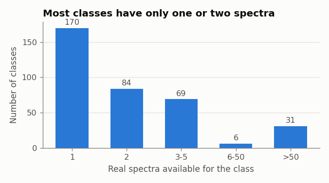
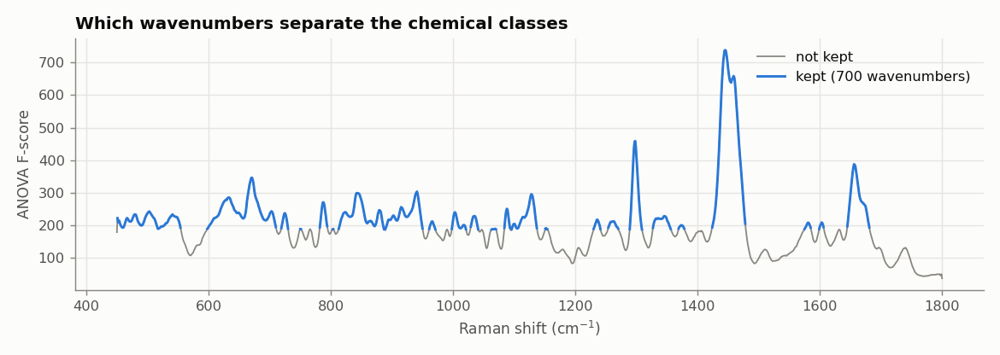
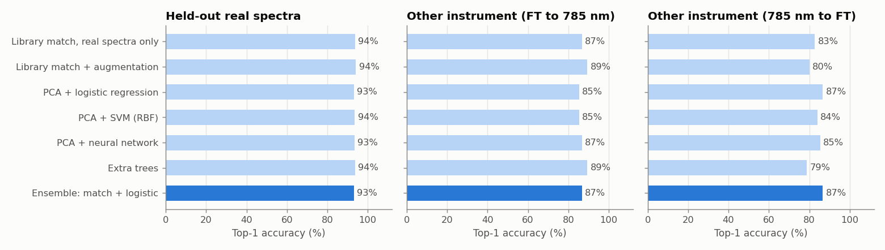

# Raman chemical identification: data, model and test report

Date: 11 October 2026

## Summary

The goal was to build a model that reads a Raman spectrum and names the chemical, using public data for training and our own instrument data for testing.

- We trained a model on 360 chemicals from public sources. On public spectra it had not seen, it names the right chemical 93% of the time, and 85 to 88% when the test spectrum comes from a different instrument than the reference.
- Only 6 of our 26 chemicals exist in public data. On those 71 spectra the model was right on 58 (82%). Sodium nitrate and acetone were fully correct; potassium nitrate was 73%; the two alcohols and potassium carbonate failed.
- No public Raman data exists for explosives or narcotics. The model therefore cannot name urea, naphthalene, PNBA, hexamine, RDX, PETN, TNT, HMX, TATB or the other 15 chemicals in our set that have no public reference.
- The main next step is to add our own spectra as references, so the model covers the chemicals we actually measure.

## 1. Data

### Our dataset

| Item | Value |
|---|---|
| Spectra | 753 |
| Labelled chemicals | 26, plus 191 spectra labelled "not in lib" |
| Points per spectrum | 3,648, covering about -106 to 3,315 cm-1 |
| Largest classes | Urea 183, Naphthalene 90, PNBA 67 |
| Smallest classes | 7 chemicals have only 1 or 2 spectra |

### Public data collected

About 1.4 GB was downloaded into `public_raman_data/`. The model uses the sources below. RRUFF (minerals) was downloaded but left out of training on request.

| Source | Spectra used | Chemicals |
|---|---|---|
| Solvents and reagents (Figshare) | 3,505 | 31 |
| Biomolecule reference library | 202 | 141 |
| Inorganic crystals (Raman Open Database) | 252 | 127 |
| Pharmaceutical excipients (Zenodo), two instruments | 150 | 56 |
| Drug adulterants (Mendeley) | 11 | 11 |
| **Total** | **4,120** | **360** |

Not used: RRUFF minerals (excluded on request), 377 organic compounds that have no chemical names, hair-dye and pigment sets whose labels are not chemical names, and 844 inorganic-crystal spectra that did not cover the required wavenumber range.

## 2. Key data insights

- **Explosives and narcotics are absent from public data.** These spectra exist only in commercial instrument libraries. Our own 753 spectra are the only source for them.
- **Most chemicals have very few spectra.** 170 of the 360 training chemicals have one real spectrum and 84 have two. Only the 31 solvents have more than 100 each.

  

- **Sources are not directly comparable.** Raw intensities range from 0-1 in one source to hundreds of thousands in another, and each instrument covers a different wavenumber range. The only region every source covers is 450 to 1,800 cm-1, so all spectra were resampled to that range.
- **Some chemicals cannot be told apart.** 33 pairs of chemicals have nearly identical spectra (for example estradiol and estriol, or the triglycerides). 19 labels were the same substance under different names or grades and were merged.
- **Our label file has an undocumented third column.** 426 rows of `chem_log.csv` carry "ON" or "OFF". Its meaning is unknown and it is not used.

## 3. Preprocessing and features

Each spectrum goes through the same steps, in training and in testing:

1. Resample to a common grid, 450 to 1,800 cm-1 in 1 cm-1 steps (1,351 points).
2. Smooth lightly.
3. Remove the background (baseline).
4. Take the square root of the intensities, so that one very tall peak does not dominate.
5. Scale each spectrum to the same overall size.

Baseline removal is the step that matters most. Without it, accuracy on a different instrument was about 41 to 59%; with it, 80 to 89%.

**Important features.** All 1,351 wavenumbers were ranked by how well they separate the chemicals. Keeping the best 700 gave the same accuracy as keeping all of them; accuracy fell when fewer than 400 were kept. The model uses these 700. They sit mainly at 451-554, 598-710, 813-950, 998-1137, 1230-1356, 1424-1478 and 1645-1681 cm-1.



**Augmentation.** Because most chemicals have one or two spectra, extra training copies were generated from each real spectrum with small wavenumber shifts, lower resolution, added background and noise, to imitate other instruments.

## 4. Model training and validation

Seven models were compared. They all scored within about one point of each other, which is within the noise of the test. The chosen model combines two methods: matching against a library of reference spectra, and a logistic regression classifier. It was trained on 28,800 spectra (real plus generated copies, 80 per chemical).

| Validation test | Spectra | Correct first guess | Correct in top 5 |
|---|---|---|---|
| Public spectra held back from training | 862 | 93.4% | 97.2% |
| Different instrument: FT-Raman reference, 785 nm test | 75 | 88.0% | 92.0% |
| Different instrument: 785 nm reference, FT-Raman test | 75 | 85.3% | 92.0% |



The held-back result is dominated by the solvents, which have many spectra each. For the 170 chemicals with a single spectrum, no real test was possible.

## 5. Test on our dataset

Six of our chemicals are in the training set, giving 71 test spectra from `spec_log.csv`.

| Chemical | Spectra | Correct | Wrong answers given |
|---|---|---|---|
| Sodium Nitrate | 20 | 20 | none |
| Acetone | 14 | 14 | none |
| Potassium Nitrate | 33 | 24 | caesium nitrate (6), calcium nitrate (2), toluene (1) |
| Ethyl Alcohol | 2 | 0 | unrelated names |
| Potassium Carbonate | 1 | 0 | sodium nitrate |
| Isopropyl Alcohol | 1 | 0 | unrelated name |
| **All six** | **71** | **58 (82%)** | |

The correct name was among the top five answers for 68 of the 71 (96%). With the three failing chemicals left out, the result is 58 of 67 (87%); that change comes from removing spectra, not from a better model.

What the test showed:

- **Public references do transfer to our instrument.** Sodium nitrate and acetone were perfect, although the model had never seen a spectrum from our instrument.
- **Nitrates are confused with each other.** Eight of the nine potassium nitrate errors were another nitrate salt. All nitrates share one dominant peak near 1,050 cm-1.
- **The alcohols failed.** With only three spectra, the cause is not known.
- **The model cannot say "unknown".** For the 682 spectra of chemicals it was not trained on, it gives a confident wrong name (urea is usually called iron sulfate, RDX boric acid). Its match scores for unknown chemicals overlap with those for known ones, so a simple cut-off does not separate them.
- **Only `spec_log.csv` works.** On `spec_wl.csv` and `spec_wol.csv`, accuracy on the same chemicals was 6% and 0%. The reason has not been investigated.

## 6. Limitations

- The model covers 6 of our 26 chemicals and none of the explosives.
- It uses only 450 to 1,800 cm-1, so information above 1,800 cm-1 (for example the C-H region near 2,900 cm-1) is ignored.
- Accuracy for chemicals with a single reference spectrum is unmeasured on real data.
- It always returns a name, even for a chemical it does not know.

## 7. Recommended next steps

1. Add our own spectra as references for urea, naphthalene, PNBA, hexamine and the explosives, and test on spectra held back from each. This is the only route to covering them.
2. Add an "unknown" decision, using our 191 "not in lib" spectra to set it.
3. Find out what `spec_wl.csv`, `spec_wol.csv` and the ON/OFF column are.
4. Measure more spectra for the chemicals that have only one or two.
5. For narcotics, license a commercial library or measure reference standards; no public data exists.

## 8. Files

| File | Purpose |
|---|---|
| `01_build_dataset.py` | Combines the public sources into one dataset |
| `02_eda.py` | Data analysis; figures in `eda/` |
| `03_train.py` | Compares preprocessing, models and features; trains the final model |
| `04_test_on_my_data.py` | Tests the model on our full dataset |
| `predict.py` | Predicts the chemical for chosen rows or a single spectrum file |
| `model/raman_model.joblib` | The trained model |
| `results/training_chemicals.csv` | All 360 training chemicals |
| `results/matching_chemicals.csv` | Chemicals in both training and our data, with line numbers |
| `results/test_matching_chemicals.csv` | Row-by-row test result |

To predict from the `raman_model` folder, using line numbers as shown in `chem_log.csv`:

```
python predict.py --spec ..\spec_log.csv --wnums ..\wnums_log.csv --labels ..\chem_log.csv --row 13 265 700
```
